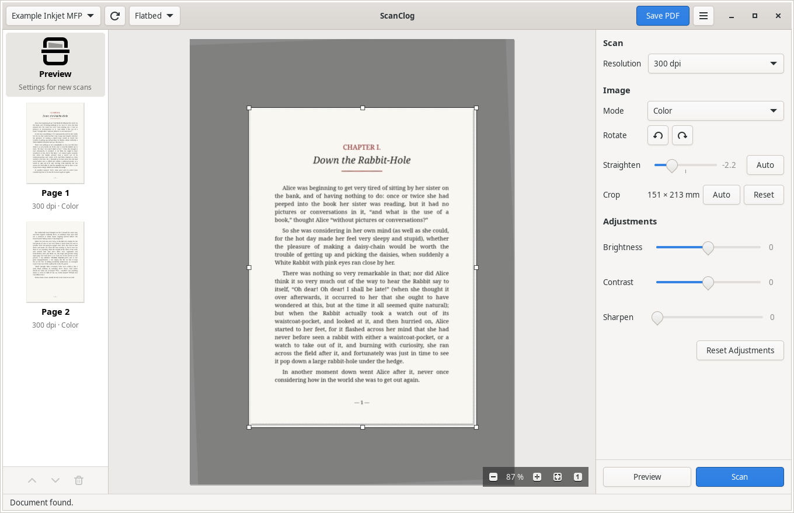
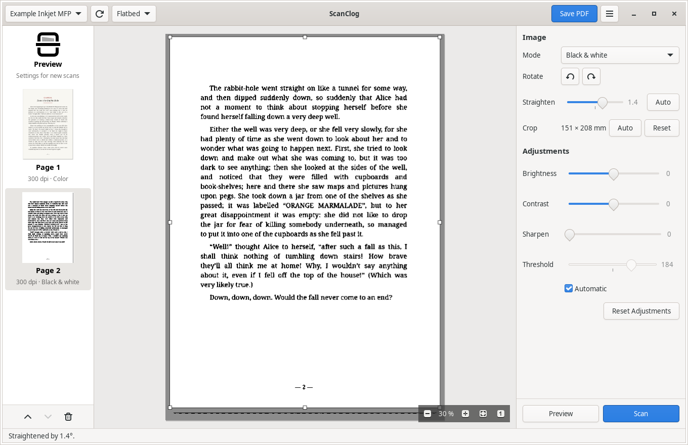

# ScanClog

[](https://github.com/ghidosoft/scanclog/actions/workflows/ci.yml)

A small scanning application for Linux that talks directly to network scanners
over **eSCL** (also known as AirScan or Mopria scan), with **non-destructive**
adjustments.

Every page keeps the image exactly as the scanner sent it. Crop, rotation,
color mode, brightness, contrast, sharpening and the black-and-white threshold
are settings applied on top of it, so you can change any of them at any time,
even after scanning, without losing quality and without scanning again.

Press **Preview** for a quick low-resolution scan of the glass: the document is
found and selected for you. Adjust the area and the settings while watching the
result, then press **Scan**. Repeat for more pages, reorder them, and save
everything as one PDF.



ScanClog is young: version 0.1, tested on one device so far (see
[Requirements](#requirements)).

## Features

- Finds eSCL scanners on the local network automatically (mDNS), or by address.
- Flatbed preview with a crop rectangle drawn directly on the image. The
  document is detected automatically; only the selected area is scanned at
  full resolution.
- Zoom down to the actual pixels of the scan, to judge sharpness and the
  black-and-white threshold.
- Color, grayscale and black-and-white output. Black and white uses a manual or
  automatic (Otsu) threshold, previewed live.
- Brightness, contrast and unsharp mask, applied identically to the preview and
  to the final page.
- Rotation in quarter turns and straightening of tilted pages.
- Document feeder (ADF) support: scans every sheet in the feeder in one go.
- Multi-page documents: thumbnails, drag-and-drop reordering, per-page settings,
  and "apply settings to all pages".
- Saves all pages as a single PDF, with compact 1-bit CCITT G4 compression for
  black-and-white pages and JPEG for color and gray pages. Untouched pages are
  embedded without re-encoding. A single page can also be exported as PNG,
  JPEG or PDF.
- Remembers the scanner and your settings between sessions.



## Requirements

- Linux with GTK 4.14 or newer (for example Linux Mint 22, Ubuntu 24.04,
  Debian 13, Fedora 40).
- A network scanner or multifunction printer that supports eSCL. Most devices
  sold in the last decade do: look for "AirPrint", "AirScan" or "Mopria" in
  their specifications.

So far ScanClog has been tested with one inkjet multifunction printer, using
both the flatbed and the document feeder.
[Reports about other devices](https://github.com/ghidosoft/scanclog/issues/new?template=device-report.yml)
are welcome, whether they work or not.

## Building and installing

You need a Rust toolchain (1.92 or newer, see [rustup.rs](https://rustup.rs))
and the GTK 4 development files:

```sh
# Debian, Ubuntu, Linux Mint
sudo apt install libgtk-4-dev build-essential

# Fedora
sudo dnf install gtk4-devel gcc
```

Then build and install into `~/.cargo/bin`:

```sh
cargo install --path .
```

To add ScanClog to the applications menu:

```sh
install -Dm644 data/io.github.ghidosoft.ScanClog.desktop ~/.local/share/applications/io.github.ghidosoft.ScanClog.desktop
```

## Usage

Start `scanclog`. The scanner is found automatically; if it is not, use
**Add Scanner by Address…** in the menu and enter its IP address.

1. Place a document on the glass and press **Preview**.
2. The document is selected automatically, and straightened if it lies
   askew on the glass. Drag the handles to adjust the area, drag elsewhere to
   draw a new one, or click outside it to start over.
3. Choose the resolution, the mode and the adjustments. The preview shows the
   result live.
4. Press **Scan**. The page appears in the list on the left.
5. Select a page to change its settings; the list entry **Preview** returns to
   the settings for new scans.
6. Press **Save PDF**.

To use the document feeder, choose it in the source menu next to the scanner.
There is no preview for the feeder: choose the paper size and press **Scan**.

### Keyboard shortcuts

| Shortcut | Action |
|---|---|
| Ctrl+P | Preview |
| Ctrl+Return | Scan |
| Ctrl+S | Save all pages as PDF |
| Ctrl+E | Export the selected page |
| Ctrl+L / Ctrl+R | Rotate left / right |
| Alt+Up / Alt+Down | Move the selected page |
| Delete | Delete the selected page |
| Ctrl+scroll, Ctrl++ / Ctrl+− | Zoom in / out |
| Ctrl+0 / Ctrl+1 | Fit to window / actual pixels |
| Scroll, Shift+scroll, middle drag | Pan a zoomed image |
| Esc | Cancel the scan |
| F5 | Search for scanners again |
| Ctrl+Q | Quit |

### Command line

Besides the graphical interface, `scanclog` has a few commands for scripting
and troubleshooting:

```sh
scanclog probe                      # list scanners and their capabilities
scanclog probe --host 192.0.2.10    # the same for a scanner given by address
scanclog scan --dpi 300 --mode gray -o page.jpg
scanclog process page.jpg --mode bw --threshold auto --straighten auto -o page.pdf
```

Run `scanclog help <command>` for all options.

## Configuration

Settings are stored in `~/.config/scanclog/config.toml` and written when the
application closes. It is safe to delete the file to return to the defaults.

## How it works

ScanClog asks the scanner for JPEG images in color and does all processing
itself. Asking for color even when the result will be gray or black and white
keeps the preview faithful: scanners convert to gray with their own formula,
which would make the final page look different from the preview. It also lets
any page change mode after scanning.

## Development

```sh
cargo test                  # unit and integration tests, no scanner needed
cargo clippy --all-targets
RUST_LOG=scanclog=debug cargo run
```

The eSCL client is tested against a scripted in-process HTTP server and
anonymized capability documents from real devices in `tests/fixtures/`.

To exercise the interface without disturbing your desktop session, run it on a
nested X server with GTK's built-in file dialogs:

```sh
Xephyr :5 -screen 1400x950 &
DISPLAY=:5 GDK_BACKEND=x11 GDK_DEBUG=no-portals cargo run
```

## License

ScanClog is released under the [MIT License](LICENSE).
